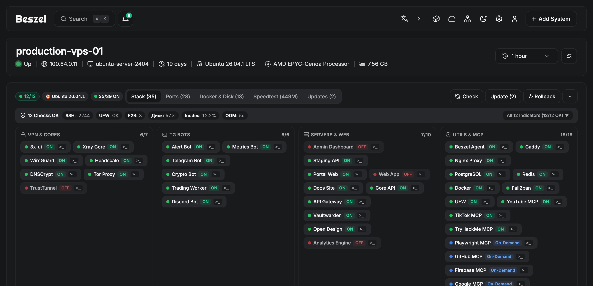
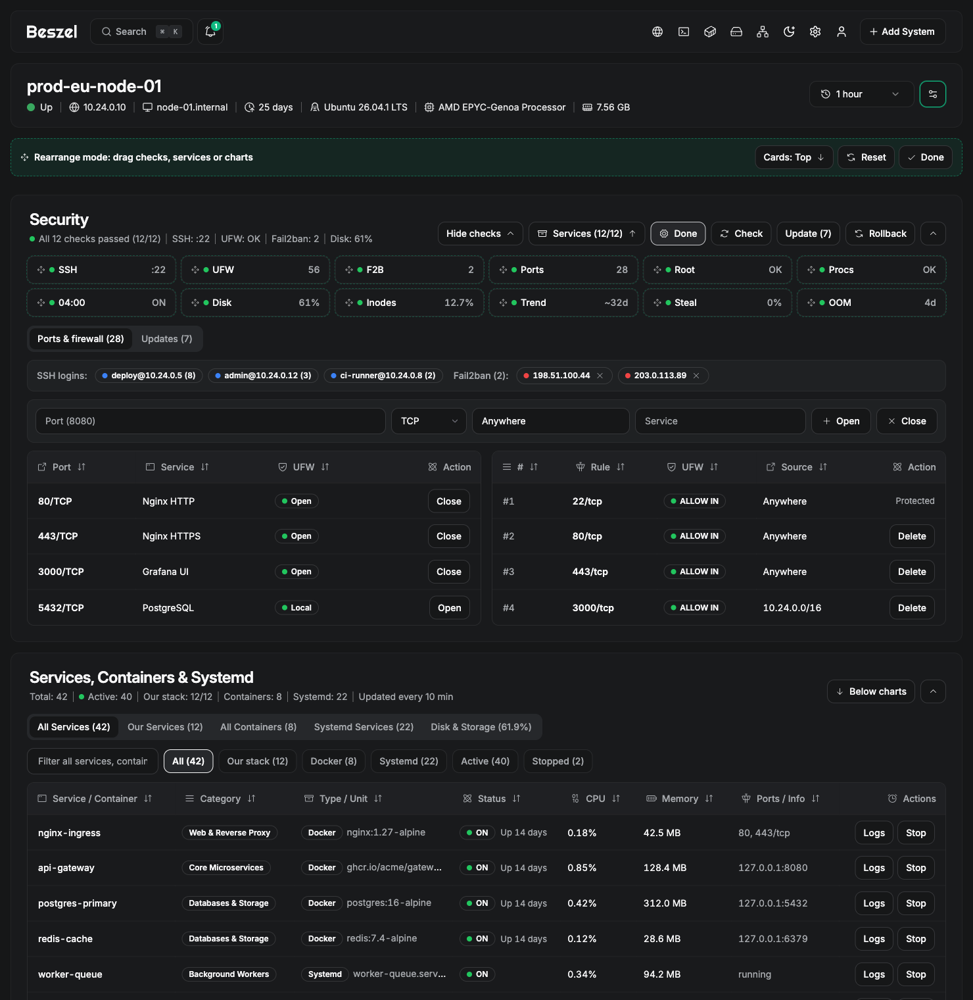
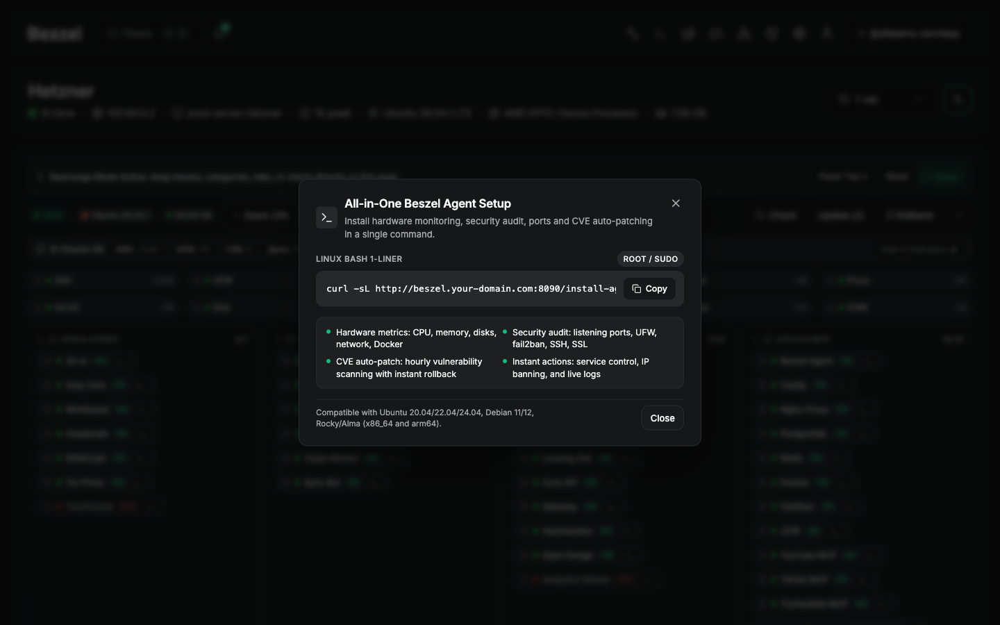

# Beszel

Beszel is a lightweight server monitoring platform that includes Docker statistics, historical data, alert functions, and integrated security telemetry.

It has a friendly web interface, simple configuration, and is ready to use out of the box. It supports automatic backup, multi-user, OAuth authentication, dashboard rearrangement, and native Go security auditing.

[](https://hub.docker.com/r/henrygd/beszel-agent)
[](https://hub.docker.com/r/henrygd/beszel)
[](LICENSE)
[](https://crowdin.com/project/beszel)


## Features

- **Lightweight**: Smaller and less resource-intensive than leading solutions.
- **Simple**: Easy setup with little manual configuration required.
- **Dashboard customization**: Per-server drag & drop rearrangement of system charts, stack categories, and service pills with visibility controls.
- **Security Radar**: Integrated CVE vulnerability tracker, active port manager, SSH login auditing, and Fail2ban monitor.
- **Pure Go architecture**: 100% written in Go with zero Python or external runtime dependencies.
- **Alerts**: Configurable alerts for most metrics. Supports many notification services.
- **Docker stats**: Tracks CPU, memory, and network usage history for each container.
- **Network monitoring**: Monitor response time and interruptions directly from agents.
- **S.M.A.R.T.**: Disk health data and notifications on drive failure.
- **Multi-user**: Users manage their own systems. Admins can share systems across users.
- **OAuth / OIDC**: Supports many OAuth2 providers. Password auth can be disabled.
- **Automatic backups**: Save to and restore from disk or S3-compatible storage.

## Architecture

Beszel consists of two main components: the **hub** and the **agent**.

- **Hub**: A web application built on [PocketBase](https://pocketbase.io/) that provides a dashboard for viewing and managing connected systems.
- **Agent**: Runs on each system you want to monitor and communicates system metrics to the hub.

## Getting started

The [quick start guide](https://beszel.dev/guide/getting-started) and other documentation is available on our website, [beszel.dev](https://beszel.dev). You'll be up and running in a few minutes.

### 1. Hub Setup

Run the quick-start script on your central server:

```bash
git clone https://github.com/bledny1099/beszel.git
cd beszel
./quick-start.sh
```

Or run directly with Docker Compose:

```bash
docker compose up -d
```

The web dashboard will be available at `http://<SERVER_IP>:8090`.

### 2. Connect Your Systems

1. Open `http://<SERVER_IP>:8090` and create your admin account.
2. Click **Add System** and copy your Hub Public Key.
3. Run the unified installer on any server you want to monitor:

```bash
curl -sL http://<HUB_IP>:8090/install-agent.sh | bash -s -- --key "<YOUR_HUB_KEY>"
```

The agent runs as an isolated systemd service, auto-discovers running containers and services, and streams hardware and security telemetry immediately.

## Security Agent

Each monitored server runs a built-in Go security subsystem (`agent/security.go` and `agent/security_actions.go`) that reports to the Hub (`internal/hub/security.go`). On the server detail page (`/system/:id`), telemetry and controls are split into three independent, collapsible cards:

1. **Security**: 8 core security checks + 4 system health indicators (hidden by default when all 12 pass, with a toggle to expand all checks), UFW port manager, Fail2ban jail monitor, SSH login log, and CVE patch status.
2. **Services**: auto-discovered Docker containers and systemd units grouped by category (`Containers`, `VPN & Proxy`, `Databases`, `Web`, `Monitoring`, `System`), with start/stop/restart controls, live log viewer, Docker storage breakdown, and disk cleanup actions.
3. **Network & domains**: ICMP/TCP latency probes (`1.1.1.1`, `8.8.8.8`, `9.9.9.9`), on-demand bandwidth speedtest, and SSL certificate expiration monitoring for configured domains. This card is automatically hidden on nodes without domains or external network probes.

### 8 Core Security Checks

| Check ID | Name | What It Inspects | Warning / Critical Condition |
| :--- | :--- | :--- | :--- |
| `ssh_auth` | SSH & Auth | `sshd -T` (`PasswordAuthentication`), `/root/.ssh/authorized_keys` key count & SHA-256 fingerprint, 24h failed logins in `journalctl` | `warn` if password auth is enabled or 24h failed attempts exceed 500 |
| `firewall` | Firewall (UFW) | `ufw status numbered`, active state, and rules covering protected ports (`22`, `2244`, `8090`, `45876`) | `warn` if UFW is inactive |
| `fail2ban` | Fail2ban | `fail2ban-client status sshd` active state and currently banned IPs | `warn` if `fail2ban` service is inactive |
| `open_ports` | Listening Ports | `ss -H -tulpn` public vs. local/Tailscale listening sockets and owning processes | Reports total and public listening ports |
| `users_priv` | Users & Privileges | `/etc/passwd` accounts with UID `0` | `crit` if any account other than `root` has UID `0` |
| `processes_integrity` | Process Integrity | `/proc/*/exe` symlinks checked for binaries executing from `/tmp`, `/var/tmp`, or `/dev/shm` | `crit` if any process runs from temporary/shared memory directories |
| `cron_timers` | Cron & Timers | `systemctl is-active beszel-security-audit.timer` and root cron jobs | Reports timer status |
| `kernel_sysctl` | Kernel & Sysctl | `/proc/sys/kernel/randomize_va_space` (ASLR) and `/proc/sys/net/ipv4/tcp_syncookies` | `warn` if ASLR is not `2` |

### 4 System Health Indicators

| Indicator ID | What It Tracks | Thresholds |
| :--- | :--- | :--- |
| `inodes` | Root filesystem inode utilization (`df -i /`) | `warn` at 80%, `crit` at 90% |
| `disk_trend` | Root partition usage (`df -BM /`), daily growth rate (`MB/day`), and estimated days until full | Alerts when projected disk exhaustion is under 14 days |
| `cpu_steal` | Hypervisor CPU steal time percentage calculated from `/proc/stat` | `warn` at 10%, `crit` at 20% |
| `oom_reboot` | 7-day kernel Out-Of-Memory kills (`journalctl -k`) and `/proc/sys/kernel/random/boot_id` changes | `warn` if any OOM kill occurred in the last 7 days |

### Schedules, Non-Restart Policy & Auto-Rollback Guard

- **10-Minute Vulnerability Watch (`beszel-vuln-watch.timer`)**: runs `beszel-agent security --vuln-watch` every 10 minutes. Checks `apt-get -s dist-upgrade` for pending security patches, installs security-only upgrades (`apt-get install -y --only-upgrade`), and sends a `vuln_patched` notification to the Hub.
- **Nightly Audit & Upgrade (`beszel-security-audit.timer`)**: runs daily at `04:00` (`beszel-agent security --full`). Performs a full non-interactive upgrade (`apt-get dist-upgrade -y`) and syncs the complete audit report.
- **Strict No-Restart Policy**: before running `apt-get`, the agent writes `/etc/apt/apt.conf.d/99-beszel-norestart` (`--force-confdef`, `--force-confold`) and `/etc/needrestart/conf.d/99-beszel-norestart.conf` (`$nrconf{restart} = 'l'`). Package upgrades never reboot the server or restart active SSH, VPN, or container sessions.
- **Pre-Flight Snapshot & Automatic Rollback**:
  1. Before installing packages, the agent saves `/var/lib/beszel-security/preflight-snapshot.json` (current package versions, expected listening ports, and failed systemd units) and copies cached `.deb` files from `/var/cache/apt/archives` to `/var/lib/beszel-security/rollback-debs`.
  2. After the upgrade finishes, the agent verifies `dpkg --audit`, `sshd -t`, `nginx -t`, expected listening ports, and checks for any newly failed systemd units.
  3. If verification fails and a broken service cannot be restarted, the agent automatically downgrades the affected packages (`apt-get install -y --allow-downgrades` or `dpkg -i` from `rollback-debs`), places them on `apt-mark hold`, and sends an `auto_rollback` alert to the Hub.

### Active Management & API Authentication

- **Firewall Ports**: open or close UFW ports directly from the Security card (`POST /api/security-port`). Protected ports (`22`, `2244`, `8090`, `45876`, or custom `protected_ports` in `/etc/beszel-security/config.json`) are locked against remote closure.
- **Fail2ban & SSH**: ban or unban IP addresses in Fail2ban (`POST /api/security-f2b`) and inspect recent SSH logins.
- **Services & Logs**: start, stop, or restart Docker containers and systemd units (`POST /api/security-service`) and view the last 80 log lines (`POST /api/security-service-logs`). Critical units (`ssh`, `beszel`) cannot be stopped remotely.
- **Maintenance Actions**: trigger on-demand telemetry sync, CVE patching, package rollback, Docker prune (`docker system prune -af`), disk cleanup (`journalctl --vacuum-time=7d`, `apt-get clean`), or bandwidth speedtest (`POST /api/security-trigger` with an explicit mode whitelist).
- **Authentication**: all browser-facing `/api/security-*` endpoints are protected by Nginx `auth_request` against PocketBase (`/api/collections/users/auth-refresh`), requiring a valid user bearer token. Agent-to-Hub report ingestion (`POST /api/security-report` and `POST /api/security-event`) authenticates via the `X-Beszel-Security-Token` header.

## Screenshots

### System Overview & Security Radar
Integrated CVE checks, active ports, Fail2ban monitor, and system telemetry:


### Drag & Drop Dashboard Rearrange Mode
Rearrange system charts, stack tabs, and visibility controls directly on the live page:



### All-in-One Agent Installer
1-liner installer for hardware monitoring and automatic security auditing:



## Tailscale Setup

Running Beszel over [Tailscale](https://tailscale.com) allows monitoring your fleet across clouds, home labs, and VPS instances with zero open firewall ports on the public internet. See the [Tailscale deployment guide](TAILSCALE.md) for complete details on ACL policies, sidecars, and troubleshooting.

### Option 1: Native Host Setup (Recommended)

If your nodes already run Tailscale:

1. **Find your Hub Tailscale IP or MagicDNS name:**
   ```bash
   tailscale ip -4
   # Example: 100.64.0.2
   ```

2. **Access the Hub web dashboard:**
   Open `http://100.64.0.2:8090` (or `http://<hub-name>.<your-tailnet>.ts.net:8090`) in your browser.

3. **Install the Agent on any Tailscale node:**
   ```bash
   curl -sL http://100.64.0.2:8090/install-agent.sh | bash -s -- --key "<YOUR_HUB_KEY>"
   ```

4. **Firewall security:**
   Lock down ports `8090` (hub) and `45876` (agent) to only accept traffic from the `tailscale0` network interface:
   ```bash
   ufw allow in on tailscale0 to any port 8090 proto tcp
   ufw allow in on tailscale0 to any port 45876 proto tcp
   ```

### Option 2: Docker Compose with Tailscale Sidecar

To isolate the Hub inside a container while exposing it strictly to your Tailnet:

```yaml
services:
  tailscale:
    image: tailscale/tailscale:latest
    container_name: tailscale-beszel
    hostname: beszel-hub
    environment:
      - TS_AUTHKEY=tskey-auth-YOUR_AUTH_KEY_HERE
      - TS_STATE_DIR=/var/lib/tailscale
      - TS_USERSPACE=false
    volumes:
      - ./tailscale-data:/var/lib/tailscale
      - /dev/net/tun:/dev/net/tun
    cap_add:
      - NET_ADMIN
      - NET_RAW
    restart: unless-stopped

  beszel:
    image: henrygd/beszel:latest
    container_name: beszel-hub
    network_mode: service:tailscale
    depends_on:
      - tailscale
    volumes:
      - ./beszel_data:/beszel_data
    restart: unless-stopped
```

### Option 3: Automatic HTTPS with Tailscale Serve

Tailscale can automatically issue Let's Encrypt certificates and terminate HTTPS for your Hub:

```bash
tailscale serve --bg 8090
```

Your Beszel dashboard is now securely available at `https://<hub-name>.<your-tailnet>.ts.net` with zero certificate configuration needed.

## Supported metrics

- **CPU usage** - Host system and Docker / Podman containers.
- **Memory usage** - Host system and containers. Includes swap and ZFS ARC.
- **Disk usage** - Host system partitions and mount points.
- **Disk I/O** - Host system partitions and devices.
- **Network usage** - Host system and containers.
- **Load average** - Host system.
- **Security Radar** - Open firewall ports, active connections, SSH login attempts, Fail2ban jails, CVE patch backlog.
- **Services & Stack** - Automatic tracking of Docker containers, systemd services, and web endpoints.
- **Temperature** - Host system sensors.
- **Fan speed** - Host system sensors (Linux, via `/sys/class/hwmon`).
- **GPU usage / power draw** - Nvidia, AMD, and Intel.
- **Battery charge** - Host system and some peripherals.
- **Containers** - Status and metrics of all running Docker / Podman containers.
- **S.M.A.R.T.** - Host system disk health (includes eMMC wear/EOL and Linux mdraid array health via sysfs when available).
- **ZFS** - Pool capacity, usage, health, I/O throughput, scrub status, and per-dataset usage.

## Help and discussion

Please search existing issues and discussions before opening a new one.

#### Bug reports and feature requests

Bug reports and feature requests can be posted on [GitHub issues](https://github.com/bledny1099/beszel/issues).

#### Upstream project

Original project and documentation: [henrygd/beszel](https://github.com/henrygd/beszel) · [beszel.dev](https://beszel.dev).

## License

Beszel is licensed under the MIT License. See the [LICENSE](LICENSE) file for more details.
